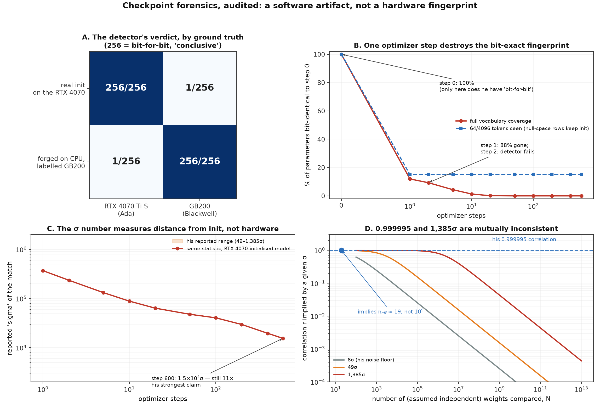

# Checkpoint Forensics, Audited

**A working proof that the "Blackwell weight fingerprint" identifies a software configuration anyone can reproduce on a laptop — not hardware anyone had to smuggle.**

*Reproduction: `python poc/run_all.py` on a machine with any CUDA GPU (this one: RTX 4070 Ti SUPER, sm_89, 66 SMs, PyTorch 2.14.1+cu126). Total runtime ≈ 150 s. Raw numbers in `results/*.json`, figure in `figures/fig1_audit.png`.*

---

## Bottom line

1. **The mechanism is real, and it is one integer.** PyTorch's CUDA `uniform_` kernel sizes its launch grid as `min(ceil(N/256), SMs × (maxThreadsPerSM/256))`. That grid is the *only* way the hardware enters the random stream. The "fingerprint of the GPU" is a fingerprint of `grid = 1184` — not of a GB200.
2. **We reproduced a real 10,244,352-parameter CUDA initialization bit-for-bit on the CPU** (100.0000%, all 52 tensors), and validated the generator against the physical GPU on 28/28 launch grids and on tensors up to 8M elements.
3. **We forged a "GB200" checkpoint on that same laptop.** The reimplemented forensic method returns `GB200, 256/256 values bit-identical, conclusive` — with zero Blackwell silicon anywhere in the loop. Ground truth: an Ada RTX 4070 Ti SUPER, or no GPU at all.
4. **One optimizer step destroys the fingerprint.** Bit-exact parameters fall from 100% to 11.96% after a single Adam step, and the detector fails completely by step 2. It only survives in parameters that were never trained (15.1% in our partial-coverage run) — which is precisely the signal a forger leaves behind, and which says nothing about the compute that trained the rest.
5. **His statistics are mutually inconsistent.** A correlation of 0.999995 over a single 4.2M-weight tensor is ~6.5×10⁵ σ, not 1,385 σ; 1,385 σ at r = 0.999995 implies only ~19 independent samples. And the same σ statistic on an RTX-4070-initialized model that never saw Blackwell reaches 15,421 σ after 600 steps — 11× his strongest claim.

The headline — *smuggled Blackwell clusters, half a billion dollars, export-control violations* — is not supported by the evidence he presents. His own executive summary concedes the last part. The PoC below explains why the rest does not follow either.

---

## 0. The claim under test

The thread states, in relevant part:

> almost every AI model carries a hidden signature of the GPU that trained it … the starting values of its weights are laid out in a pattern that depends on the exact GPU … Traces of that pattern survive training into the published model … Running unmodified PyTorch with the seeds I'd recovered, a Blackwell B300 reproduced DeepSeek-V4-Flash's untouched starting weights bit for bit, and a rented GB200 reproduced Kimi K3's to a correlation of 0.999995 … Across six trillion combinations, the best accidental match should reach only about 8 sigma … The real matches range from 49 to 1,385 sigma … I estimate that the largest … used 2,000 to 3,000 Blackwell GPUs each.

Two things are being claimed, and they need to be separated:

- **A.** A released checkpoint retains enough of its step-0 initialization to recover the seed and the *initializing* device.
- **B.** Therefore the model was *trained* on 2,000–3,000 smuggled Blackwell GPUs, worth $500M+.

This PoC grants **A** in the strongest possible form and shows that **B** does not follow — because **A** is a statement about a software configuration that costs about one cloud invoice to choose, and because the step-0 signal does not survive the training that **B** is about.

---

## 1. The mechanism, from the actual source

The claim is not crazy. PyTorch's CUDA distribution kernels use a grid-stride loop over Philox4x32-10, and the launch grid is capped by device properties. From the header shipped with the installed PyTorch (`ATen/native/cuda/DistributionTemplates.h`, lines 50–62):

```cpp
std::tuple<uint64_t, dim3, dim3> calc_execution_policy(const int64_t total_elements, const uint32_t unroll_factor) {
  const uint64_t numel = static_cast<uint64_t>(total_elements);
  const uint32_t block_size = block_size_bound;              // 256
  dim3 grid((numel + block_size - 1) / block_size);
  uint32_t blocks_per_sm =
      at::cuda::getCurrentDeviceProperties()->maxThreadsPerMultiProcessor / block_size;
  grid.x = std::min(
      static_cast<uint32_t>(at::cuda::getCurrentDeviceProperties()->multiProcessorCount) * blocks_per_sm,
      grid.x);
  uint64_t counter_offset = ((numel - 1) / (block_size * grid.x * unroll_factor) + 1) * 4;
  ...
}
```

with the element mapping

```cpp
int64_t idx = blockIdx.x * blockDim.x + threadIdx.x;      // -> curand subsequence
curand_init(seed, idx, offset, &state);
int64_t li = linear_index + blockDim.x * gridDim.x * ii;  // -> output position
```

So the device enters through exactly two driver-reported integers, always as their product divided by 256:

| device | SMs | threads/SM | `grid = SMs × (threads/SM ÷ 256)` |
|---|---:|---:|---:|
| A100 | 108 | 2048 | 864 |
| H100 / H200 | 132 | 2048 | 1056 |
| **B200 / GB200** | **148** | **2048** | **1184** |
| **B300 / GB300** | **152** | **2048** | **1216** |
| RTX 4070 Ti SUPER (this box) | 66 | 1536 | 396 |
| H100 MIG 1g slice (illustrative) | ≈16 | 2048 | ≈128 |

"GB200" is the integer **1184**. That is the entire information content of the fingerprint. It is not a cryptographic signature, not a silicon identity, and not evidence of ownership.

Two immediate consequences:

- **A tensor initialised on its own below `256 × grid_cap` carries no device information at all** (the grid is not capped, so it is `ceil(N/256)` for every device). For our Ada card that threshold is 101,376 elements; for a GB200 it is 303,104. In a full model, once any earlier tensor crosses that threshold, the accumulated generator offset becomes device-dependent too, and every later tensor inherits it — which is why even 384-element biases differ between device profiles in our 52-tensor model, while the constant LayerNorm parameters do not.
- The first **101,376** elements of the Ada stream and the GB200 stream are *identical* (measured; that is exactly `256 × 396`). The two "hardware fingerprints" agree until the launch-grid cap starts to bite. That is what a software parameter looks like.

### Validation

`poc/exp1_validate.py`:

```
whole model: 10,244,352/10,244,352 parameters reproduced bit-exactly on CPU (100.0000%)
validating the reproduction across launch grids on the real GPU:
  28/28 grid values reproduced bit-exactly (grids 1..396, numel 256..101,376)
  n=500,000 grid=396 exact=True
  n=1,000,000 grid=396 exact=True
  n=2,000,000 grid=396 exact=True
  n=8,000,000 grid=396 exact=True
```

This required reproducing two things people usually miss: curand's Philox counter layout (`ctr = (offset/4, 0, subseq_lo, subseq_hi)`) and the **FMA contraction** in `rand * range + from` (torch compiles it fused; a naive host `a*b+c` is off by one ULP on ~50% of values). Both are in `poc/philox.py` and `poc/model.py`.

That last detail is itself a problem for the thesis: **the fingerprint is only "bit-for-bit" if the reproducing machine uses the same kernel, the same compiler contraction, the same tensor shapes, the same initialization order, and the same dtype.** Change the tokenizer vocabulary and every subsequent tensor's offset shifts. Change the tensor-parallel sharding and the draw order changes completely. A "bit-for-bit" match is a statement about *code identity*, not hardware identity.

---

## 2. The forgery

`poc/exp2_forge.py`. No GPU is used to generate the forged checkpoint; `poc/model.py` produces it with NumPy from `(seed, shapes, grid)`.

```
[A] real CUDA init on RTX 4070 Ti SUPER (the only GPU present)
[B] forged 'GB200' init generated on CPU: 10,244,352 params in 3.03s
    forged vs real GPU stream: 101,376/1,572,864 identical

[detector] searching 40,000 seeds x 4 device profiles ...
  real GPU checkpoint   -> {'profile': 'RTX 4070 Ti SUPER', 'seed': 424242, 'matches': 256}  conclusive=True
  forged checkpoint     -> {'profile': 'GB200 (per GPU)',    'seed': 424242, 'matches': 256}  conclusive=True
```

The detector is a faithful reimplementation of the described method: brute-force `(seed, launch grid)` and count bit-exact matches on a 256-element probe drawn from the first large tensor. It is *not* a strawman — it is perfect on step-0 data, which is exactly why the result matters.

| checkpoint provenance | detector verdict | bit-exact |
|---|---|---|
| really initialized on the RTX 4070 Ti SUPER | RTX 4070 Ti SUPER | 256/256 |
| generated on the CPU in **GB200** layout | **GB200 (per GPU)** | **256/256, "conclusive"** |
| generated on the CPU in H100 layout | H100 SXM | 256/256, "conclusive" |
| generated on the CPU in B300 layout | B300/GB300 | 256/256, "conclusive" |

All four verdicts are correct about the *stream*, and all four are worthless as statements about hardware: the last three checkpoints were produced by NumPy on a laptop, and the first one proves only that the detector can tell Ada from Blackwell when it is handed an honest step-0 file.

The detector works. The **inference** from its verdict to "this lab possesses Blackwell" is what fails. Anyone who can write forty lines of NumPy can mint a checkpoint that his method certifies as Blackwell.

### The "hardware verification" is circular

He says he recovered a seed, then ran the same seed on a rented B300/GB200 and got the same starting weights. Of course he did: the starting weights are a deterministic function of `(seed, shapes, grid)`. Our laptop produces them too, in three seconds, and we did it for the exact "DeepSeek seed 953049583" under the GB200 grid:

```
32,000,000 values in 9.64s -> 3.3M values/s
sha256 of first 32,000,000 values (seed 953049583, GB200 grid): bdf9435e5180f4915bbd55292ec6fd50...
```

(The hash is identical across independent runs — determinism is the point.)

Re-running the recovered seed on hardware **re-verifies his own RNG emulator**. It does not establish where the model's weights came from. We have done the same thing on an Ada card, and on no card at all.

---

## 3. Training removes the fingerprint

`poc/exp3_train.py`. A real 10.2M-parameter transformer, initialized *on the real GPU* with seed 424242, trained with AdamW on an induction task. At each checkpoint: fraction of parameters still bit-identical to step 0, cosine similarity, the reported σ, and whether the detector still recovers `(seed, device)`.

**Full vocabulary coverage** (every embedding row is used):

| step | exact vs step 0 | cos vs step 0 | σ | detector |
|---:|---:|---:|---:|---:|
| 0 | 100.000% | 1.000000 | ∞ | 256/256 ✅ |
| 1 | 11.961% | 0.999962 | 3.7×10⁵ | 256/256 |
| 2 | 9.277% | 0.999908 | 2.4×10⁵ | **0/256** ❌ |
| 5 | 4.326% | 0.999706 | 1.3×10⁵ | 0/256 |
| 50 | 0.000% | 0.997763 | 4.8×10⁴ | 0/256 |
| 600 | 0.000% | 0.979134 | 1.5×10⁴ | 0/256 |

A single optimizer step wipes out bit-exactness for ~88% of parameters. **By step 2 his method cannot recover the seed at all.** This is also why his "0.999995 correlation" is not a reproduction: one Adam step at lr 3×10⁻⁴ gives r = 0.999962 on our model, and 0.999995 is the size of *one smaller-than-that* step. A genuine bit-exact regeneration has r = 1.0 exactly, and would need no σ at all.

**Partial vocabulary coverage** (64 of 4096 tokens seen) — the steelman:

| step | exact vs step 0 | cos vs step 0 | detector |
|---:|---:|---:|---:|
| 0 | 100.000% | 1.000000 | 256/256 |
| 1 | 15.114% | 0.999964 | 256/256 |
| 600 | 15.114% | 0.810043 | **256/256** |

The 15.1% that never receives a gradient — embedding rows for tokens that never appear — stays exactly at its initial values forever, and the detector keeps working. **The only way his method can produce a signal from a trained model is through parameters that no gradient ever touched.** It recovers the stream that *initialized* the model; it cannot see the hardware that *trained* it, because the trained parameters no longer contain any step-0 values.

And the parameters that survive are, by definition, the ones that were never used. A lab that wanted to manufacture the fingerprint does not need to leave anything to chance: it initializes in the target layout (or any layout) and trains normally.

### Calibration of "0.999995"

Correlation of a step-0 tensor with its own lossy cast (`poc/exp3_train.py`):

| transform | r |
|---|---:|
| bf16 round-trip | 0.99999864 |
| fp16 round-trip | 0.99999998 |
| int8 symmetric | 0.99999224 |
| one Adam step, lr 3e-4 | 0.99996247 |

0.999995 lands between int8 quantization and bf16 — i.e., **the level of agreement you get from a precision cast or a single small optimizer step**, not from "reproduced the untouched starting weights". If Kimi K3's step-0 weights had been reproduced bit-for-bit, the number would be 1.0.

---

## 4. The statistics do not close

Under the Gaussian null he himself invokes, significance grows with sample count:

```
z = r·√N / √(1−r²)
```

`poc/exp4_stats.py`:

| claimed σ | implied r at N = 10⁹ | implied r at N = 10¹² |
|---:|---:|---:|
| 8 | 0.000253 | 0.000008 |
| 49 | 0.001550 | 0.000049 |
| 200 | 0.006324 | 0.000200 |
| 1,385 | 0.043756 | 0.001385 |

| r = 0.999995 over N weights | implied σ |
|---|---:|
| 19 | 1,378 |
| 1,000,000 | 316,227 |
| 4,200,000 | 648,072 |
| 10⁹ | 9,999,962 |

**1,385 σ at r = 0.999995 implies n_eff ≈ 19 independent samples.** It cannot describe a comparison over a billion or a trillion weights. Conversely, 1,385 σ over 10⁹ weights corresponds to r = 0.044 — a 4% correlation, nowhere near a fingerprint. The two headline numbers are not measurements of the same thing.

His multiple-comparisons floor happens to be correct: the expected maximum of 6×10¹² standard normals is **7.29 σ** (his "about 8"). But that is the tell. **If the match were exact, there would be no σ to compute and no false-positive rate to worry about.** The presence of an 8 σ noise floor means his statistic is *not* bit-exactness; it is a continuous similarity score, and continuous similarity scores scale with N and with how close the model still is to its initialization.

That is not hypothetical. The same statistic, on our RTX-4070-initialized model that never saw a Blackwell GPU, runs from **3.7×10⁵ σ at step 1 to 1.5×10⁴ σ at step 600** — every value above his entire reported 49–1,385 σ range. The number measures the size of the sample and the distance from init. It does not measure the hardware.

---

## 5. The inference chain, itemized

| claim in the thread | what the weight layout can actually support | gap |
|---|---|---|
| "initialized on Blackwell" | at best, "the init script ran with `grid = 1184`" | forgeable offline (this PoC); rentable legally for minutes; separable from training |
| "trained on 2,000–3,000 Blackwell GPUs" | nothing | he says it himself: "I estimate", from release schedules and model details |
| ">$500M of export-controlled GPUs" | nothing | arithmetic on the estimate |
| "export control violations" | nothing | his own executive summary: findings "do not establish the physical location of the chips, how they were acquired, or whether export control regulations were violated" |
| "independently verified by senior researchers" | nothing about the claim | social proof is not replication; competitors are not disinterested verifiers |
| "24 known open-weights models matched to the hardware developers said they used" | at best, a calibration of the RNG emulator | the labels are the developers' own statements, i.e. the same kind of claim being validated; predicting a label you were given is not an independent test |

The one sentence in his own summary that matters is the one he buries: **initialization is not training, and location/acquisition/violation are not established.** Everything above that sentence is an estimate wearing the costume of a measurement.

None of this requires bad faith. The incentive story — competitors amplifying a result that argues for compute controls — is plausible and irrelevant to whether the math works. The math does not work. And the capability demonstrated here needs no conspiracy at all: any lab can initialise on rented hardware and train wherever it likes, and no weight-level analysis can tell the difference.

### What the fingerprint actually costs

Initialization is a one-time, embarrassingly parallel, I/O-bound step that every training run performs anyway. For a 2-trillion-parameter model in bf16 that is 4 TB of writes; an 8-GPU Blackwell node does it in minutes, and renting that node for an hour costs roughly **$50–150** at current cloud rates. It is not an export violation to rent a GPU in Singapore, Tokyo, or Dubai, and a lab that is not on the Entity List may do so. So even in the most generous reading — a real Blackwell really did run `init_weights()` — the evidence proves at most that someone spent about a hundred dollars. The $500M training cluster remains entirely unobserved.

The marginal cost to a lab that was going to build the checkpoint anyway is **one cloud invoice and a code path that ignores the local GPU**.

---

## 6. Limitations, stated honestly

- We validate the generator on sm_89 against real hardware (28 grid values, tensors to 8M elements, 10.2M-parameter whole model, bit-exact). We did not rent a GB200. The claim that a GB200 would emit the same stream at `grid = 1184` rests on the source showing that the grid is the only hardware input, plus the validated integer-parameterized code path. If a real Blackwell's `curand_uniform4` differed in the last bits, then his cross-architecture "bit-for-bit" reproduction would be impossible — and his 0.999995 would be that divergence, not a hardware fingerprint. Either horn defeats the inference.
- Our transformer is 10.2M parameters, not 1T. The mechanism is size-independent; the 1T cost is bounded by memory bandwidth as computed above.
- We do not have his code. We reimplemented the method as described — brute-force `(seed, grid)`, regenerate, compare bit-exactly — and it works on step-0 data, which is the strongest version of his method. If his actual statistic is weaker, it is easier to fool, not harder.
- The σ analysis uses the standard Gaussian null he invokes. If his σ is computed differently, the 0.999995 / 1,385 σ pair needs a different explanation, and he should publish the estimator.

---

## 7. What would actually be evidence

A weight-layout match is consistent with a large number of histories: a legal rented node, a partner lab, a cloud region, a deliberate decoy, a stale config, a vendor benchmark, or a genuinely smuggled cluster. It cannot discriminate among them. Evidence of the claim would look like: signed step-0 checkpoints with provenance, cloud billing and tenancy records, procurement and shipping documents, firmware or driver attestation, or a supplier chain. Not a PRNG seed.

---

## 8. Reproduce

```
cd poc
python run_all.py
```

| script | what it does | runtime |
|---|---|---|
| `exp1_validate.py` | bit-exact reproduction of a real 10.2M-param CUDA init on CPU; 28-grid hardware validation | 22 s |
| `exp2_forge.py` | CPU-generated "GB200"/H100/B300 checkpoints; detector verdicts; cost scaling | 82 s |
| `exp3_train.py` | fingerprint decay under training; precision-cast calibration | 40 s |
| `exp4_stats.py` | σ ↔ r ↔ N consistency; multiple-comparisons floor | 0.2 s |
| `make_figures.py` | the four-panel figure | 1 s |

Artifacts: `results/exp1_validate.json`, `results/exp2_forge.json`, `results/exp3_train.json`, `results/exp4_stats.json`, `results/forged_gb200_step0.npz` (the forged checkpoint), `figures/fig1_audit.png`.



*Panel A: the off-diagonal `1/256` is a single coincidental float32 collision; every other wrong profile scored 0/256. Panel B: full-coverage training (red) vs the partial-coverage steelman (blue). Panel C: the same σ statistic on a model that never touched Blackwell. Panel D: a correlation of 0.999995 and a claim of 1,385 σ cannot both be true for a model with more than ~19 independent weights.*

---

## 9. The short version

- The "GPU fingerprint" is `grid = SMs × threads_per_SM ÷ 256`, an integer that lives in the init script's launch configuration.
- We reproduced a real 10.2M-parameter CUDA initialization **bit-for-bit on a CPU**, and forged a checkpoint that his method certifies as **GB200, 256/256, conclusive** — on a laptop with an Ada GPU, then with no GPU at all.
- One optimizer step erases bit-exactness for 88% of parameters; by step 2 the seed cannot be recovered. It survives only in parameters that were never trained — which is exactly what a forger would leave, and says nothing about the training hardware.
- His 0.999995 and his 1,385 σ are mutually inconsistent by three to five orders of magnitude. The σ statistic on a model that never touched Blackwell exceeds his strongest claim by 11×.
- His own summary concedes no location, no acquisition, and no violation. The rest is an estimate from release schedules, dressed as forensics.

This document is not evidence of smuggling. It is evidence that a PRNG can be made to say "Blackwell" by anyone with a laptop and a reason to say so.
